# VP Verification using the Digital Credentials (DC) API

### **Inji Verify v1.0.0-rc.1**

### VP Verification using the Digital Credentials (DC) API

The Digital Credentials API (DC API) lets Inji Verify request credentials directly through the browser, instead of sending the wallet a QR code or a deep link. The browser itself (Chrome) acts as the broker: it discovers the wallets available on the device, shows the consent screen, and returns the Verifiable Presentation to Inji Verify.

Inji Verify supports DC API through following Use-cases:

* **Same Device (Mobile)**: Verifier and wallet are on the same mobile device.
* **Cross Device from Desktop**: Verifier runs on a desktop browser; the credential lives in a wallet on a mobile device. The browser generates the QR code.
* **Cross Device from Mobile**: Verifier runs on a mobile browser; the credential lives in a wallet on a second mobile device.

**Pre-requisites**

* Chrome (or a Chromium-based browser) with Digital Credentials API support.
* A DC API–compatible wallet installed on the device holding the credential (for example, the Multipaz wallet or CMWallet - for interop testing we have used mentioned Wallet’s).
* The Inji Verify portal must be served over HTTPS.

### Same Device Flow (Mobile)

#### Step 1: Initiate VP Request Process

* Open the Inji Verify portal on your mobile device and navigate to the **‘VP Verification’** tab, the stepper shows four stages of the flow:
  * 1 - Initiate VP Request Process.
  * 2 - Select Credential Types.
  * 3 - Share Verifiable Credentials from Wallet.
  * 4 - View Verification Results.
* Click **‘Request Verifiable Credentials’** to begin.

<figure>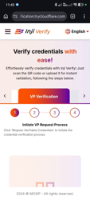<figcaption></figcaption></figure>
_Mobile View_

#### Step 2: Select Credential Types

* The **‘Verifiable Credential Selection Panel’** popup appears.
* Search using the **Search VC Type** box or reorder the list using **Sort by**, then check-select the credentials you want to request (for an example, **EU Personal ID (SD-JWT)**). Some credentials may already be pre-selected based on configuration.
* Three action buttons are available:
  * **Generate QR Code** - Cross-device flow (Wallet on another device).
  * **Open Wallet** - DC API flow (Wallet on this device).
  * **Open Web Wallets** - Browser-based wallets.
* Click **‘Open Wallet’** to continue with the DC API flow.
* If you do not wish to proceed, click **Go Back** to return to the ‘VP Verification’ tab.

<figure>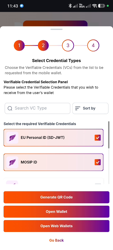<figcaption></figcaption></figure>
_Mobile View_

#### Step 3: Grant Browser Permission to Access the Digital Wallet

* The browser displays the prompt **“Do you trust this site with your data?”**, stating that the Inji Verify site wants to use personal info from your digital wallet.
  * Click **Continue** to allow the browser to query the wallets on your device.
  * Clicking **Cancel** aborts the request and returns you to the ‘VP Verification’ screen.

<figure>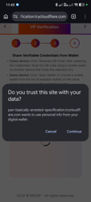<figcaption></figcaption></figure>
_Mobile View_

#### Step 4: Review the Credential in the Browser ‘Share info’ Sheet

* The browser opens the **‘Share info’** sheet listing every credential on the device that matches the request, along with the issuer name.
* Under **‘This information will be shared:’** the sheet lists exactly the claims that will be disclosed - for example, _given\_name_, _family\_name_, _age\_equal\_or\_over.18_.
  * Tap **View details** or the **›** arrow on a credential to inspect it further.
    * If more than one credential matches, scroll the list and select the one you want to present, Two actions are available:
      * **Agree and continue** - Proceed with the selected credential on this device.
      * **Switch device** - Hand the request over to a wallet on another device (see Flow C).
* Click **‘Agree and continue’**.

<figure>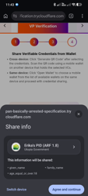<figcaption></figcaption></figure>
_Mobile View - matching credential (Erika’s PID, ARF 1.8)_

<figure>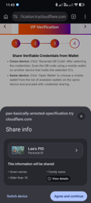<figcaption></figcaption></figure>
_Mobile View - a second matching credential (Lee’s PID) with View details_

#### Step 5: Authenticate and Consent in the Wallet

* The selected wallet application (for example, the **Multipaz Test App**) opens and displays the credential card along with the requesting origin.
  * The wallet lists the data that will be shared with the verifier — _Given names_, _Family name_, _Older than 18_.
  * The wallet may show a caution banner such as **“The website requesting this data is unknown. Make sure you are comfortable sharing this data”** when the verifier is not on a trusted verifier list.
* Authenticate if prompted, then click **Share** to consent. Click **Cancel** to abort.

<figure>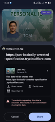<figcaption></figcaption></figure>
_Mobile View_

#### Step 6: Presentation Returned to Inji Verify

* The wallet shows the confirmation **“The info was shared”** and the browser automatically returns to the Inji Verify tab.
* Inji Verify receives the `vp_token` through the browser, validates it, and moves the stepper to step 4 — **View Verification Results**.

<figure><figcaption></figcaption></figure>_Mobile View_

#### Step 7: View Verification Results

* Inji Verify displays the outcome of the verification. For a valid credential, the banner reads **“Congratulations, the given credential is valid!”** with a **Valid** status chip against the credential type (for example, `Urn:eudi:pid:1`).
* The result card shows:
  * **Status** — Including the revocation `status_list` index and URI, where available.
  * The disclosed claims and their values (for example, _Given\_name: Lee_, _Family\_name: Tom_, _Age\_equal\_or\_over 18: true_).
  * An **eye icon** next to each claim. As the on-screen note explains, _“Fields next to this icon indicate that the information was shared selectively by the wallet holder.”_
* Use the **download** icon to save the credential data as a JSON file, and the **full screen** option to view it enlarged.
* Credential status may be **Valid**, **Valid but Expired**, **Invalid**, or **Revoked**.
* Click **‘Request Verifiable Credentials’** to start a fresh verification.

<figure>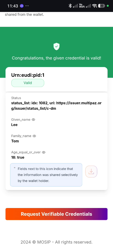<figcaption></figcaption></figure>
_Mobile View_

### Cross Device Flow from Desktop

Use this flow when Inji Verify is open on a desktop browser and the credential is kept in a wallet on your mobile device.

#### Step 1: Initiate VP Request and Select Credential Types

* Open the Inji Verify portal on your desktop browser and go to the **‘VP Verification’** tab.
* Click **‘Request Verifiable Credentials’**; the **‘Verifiable Credential Selection Panel’** appears.
* Select the required credentials (for example, **EU Personal ID (SD-JWT)**, **MOSIP ID**) and click **‘Open Wallet’**.

<figure>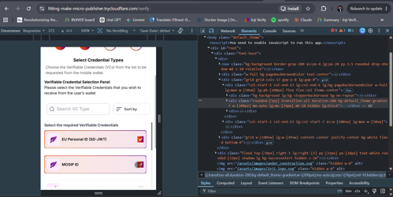<figcaption></figcaption></figure>
_Desktop View_

#### Step 2: Grant Browser Permission

* The browser shows **“Do you trust this site with your data?”** — _“…wants to use personal info from your digital wallet.”_
* Click **Continue**.

<figure>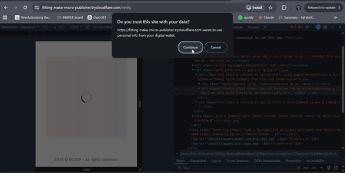<figcaption></figcaption></figure>
_Desktop View_

#### Step 3: Scan the Browser-Generated QR Code

* Because no matching credential is present on the desktop, the browser displays the dialog **“Use another device by scanning the QR code”** — _“…wants to get info from your mobile device.”_
* A QR code is rendered **by the browser itself** (not by the Inji Verify page). Inji Verify continues to show its loading indicator in the background while the exchange is in progress.
* Scan this QR code using the mobile device that holds the credential, Click **Cancel** at any time to abandon the request.

<figure>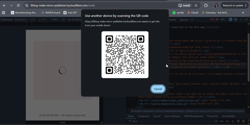<figcaption></figcaption></figure>
_Desktop View_

#### Step 4: Complete the Exchange on the Mobile Device

* Once the QR code is scanned, the desktop dialog changes to **“Follow the steps on your other device”** with a device-pairing animation, indicating that the secure cross-device channel has been established.
* On the mobile device, select the credential, review the claims to be shared, authenticate, and give consent in the wallet (same wallet screens as in Flow 1 i.e. 'Same Device Flow (Mobile)' - Step 5).

<figure>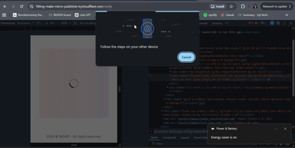<figcaption></figcaption></figure>
_Desktop View_

#### Step 5: View Verification Results

* On successful sharing, the browser dialog closes and Inji Verify advances to next step — **View Verification Results** — and renders the verification outcome for each credential shared from the wallet.
* Each credential is shown with its status (**Valid** / **Valid but Expired** / **Invalid** / **Revoked**), its disclosed claims, and options to **Download the JSON** or **Expand** the view.

<figure>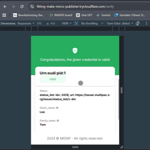<figcaption></figcaption></figure>
_Desktop View_

<figure>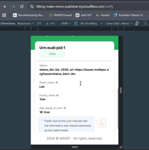<figcaption></figcaption></figure>
_Desktop View — scrolled to the disclosed claims and selective-disclosure note_

> **Troubleshooting Note:** During this flow the portal calls `vp-session-request`, the DC API (`dc-api`), and `vp-session-results` in sequence. These calls are visible in the browser’s Network tab and are useful when troubleshooting a failed exchange.

### Cross Device Flow from Mobile

Use this flow when Inji Verify is open on one mobile device and the credential is held in a wallet on a _second_ mobile device.

#### Step 1: Initiate VP Request and Select Credential Types

* Open Inji Verify on the first (verifier) mobile device, go to **‘VP Verification’**, and click **‘Request Verifiable Credentials’**.
* In the **‘Verifiable Credential Selection Panel’**, select the credentials to request (for example, **MOSIP ID**, **CMWallet EUDI PID (dc+sd-jwt ARF 1.8)**).
* Click **‘Open Wallet’**.

<figure>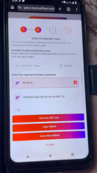<figcaption></figcaption></figure>
_Mobile View_

#### Step 2: Choose to Use a Different Device

* The browser searches the wallets available on this device. Since the requested credential is not available locally, it displays the sheet **“Your info wasn’t found”** — _“You can use your info that’s available on another device.”_
* Click **‘Use a different device’**, or click **Close** to abort the request.)

<figure>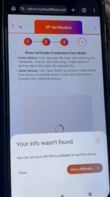<figcaption></figcaption></figure>
_Mobile View_

#### Step 3: Display the QR Code on the Verifier Device

* The browser displays the sheet **“Scan this QR code”** — _“Scan this QR code with the device that has the credential for Chrome that you’d like to use.”_
* Keep this screen open on the verifier device.

<figure>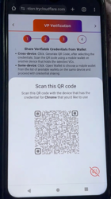<figcaption></figcaption></figure>
_Mobile View_

#### Step 4: Scan the QR Code from the Wallet Device

* On the second mobile device (the one holding the credential), open the camera or **Google Lens** and point it at the QR code displayed on the verifier device.
* A **‘Use passkey’** chip appears over the scanned QR code. Tap it.
* The device displays **“Connecting with another device”** while the secure cross-device channel is established between the two phones.

<figure>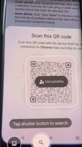<figcaption></figcaption></figure>
_Mobile View — scanning the QR code with Google Lens_

<figure>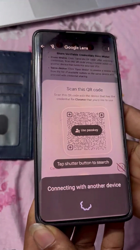<figcaption></figcaption></figure>
_Mobile View — establishing the cross-device channel_

#### Step 5: Authenticate and Consent in the Wallet

* The wallet on the second device (for example, **CMWallet**) opens and prompts **“Verify your identity — Touch the fingerprint sensor”**.
* After authentication, the wallet lists the credential and the claims requested and asks for consent.
* Tap **Share** to send the Verifiable Presentation back to the verifier device.

<figure>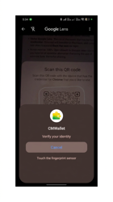<figcaption></figcaption></figure>
_Mobile View_

#### Step 6: View Verification Results on the Verifier Device

* The verifier device automatically returns to Inji Verify and advances to next step — **View Verification Results**, where the verification outcome is displayed for the shared credential:
  * **Valid** — green banner: _“Congratulations, the given credential is valid!”_
  * **Invalid** — red banner: _“Unfortunately, the given credential is invalid!”_
  * Other possible statuses are **Valid but Expired** and **Revoked**.
* The disclosed claims are listed below the status, with the selective-disclosure icon against each claim that the holder chose to share, and options to **download** the VC as JSON or **expand** it to full screen.

<figure>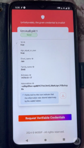<figcaption></figcaption></figure>
_Mobile View — the example below shows an invalid credential result_

### Error Handling — DC API Flows

| Scenario                                                                                                   | Behaviour / Message                                                                                                                                                                 |
| ---------------------------------------------------------------------------------------------------------- | ----------------------------------------------------------------------------------------------------------------------------------------------------------------------------------- |
| The user declines the browser permission prompt (**Cancel** on _“Do you trust this site with your data?”_) | The request is aborted and Inji Verify returns to the ‘VP Verification’ screen with no result.                                                                                      |
| No matching credential is present on the device                                                            | The browser shows **“Your info wasn’t found — You can use your info that’s available on another device”** with the options **Use a different device** and **Close**.                |
| The user cancels the QR dialog or the wallet consent screen                                                | The exchange is terminated; Inji Verify returns to the ‘VP Verification’ screen and a fresh request must be initiated.                                                              |
| The verifier is not recognised by the wallet                                                               | The wallet displays the caution **“The website requesting this data is unknown. Make sure you are comfortable sharing this data”**. The user may still choose to proceed or cancel. |
| The credential presented fails verification                                                                | Inji Verify displays **“Unfortunately, the given credential is invalid!”** along with the credential details.                                                                       |
| The browser does not support the Digital Credentials API                                                   | The **‘Open Wallet’** option cannot complete; use the **‘Generate QR Code’** (standard OpenID4VP cross-device) flow instead.                                                        |
| No internet connectivity                                                                                   | **‘No Internet Connection! Oops! We can’t seem to connect. Check your internet connection and try again’**                                                                          |
| Server unavailable                                                                                         | **‘The service is currently unavailable. Please try again later’**                                                                                                                  |

***

### Notes

1. In DC API flows the browser — not the Inji Verify page — renders the wallet selector, the consent sheet, and the cross-device QR code. The Inji Verify page shows a loading indicator until the browser returns the presentation.
2. The claims listed on the browser and wallet consent screens are exactly those requested by Inji Verify in the DCQL query for the selected credential types.
3. For every VC displayed after verification, the verifier can download the VC in JSON format and expand it to full view.
4. For SD-JWT credentials, claims that were selectively disclosed by the holder are marked with a dedicated icon in the result card.
5. The wallet shown is the **Multipaz Test App** in Flows 1 and 2, and **CMWallet** in Flow 3. The exact wallet UI varies by wallet vendor.
